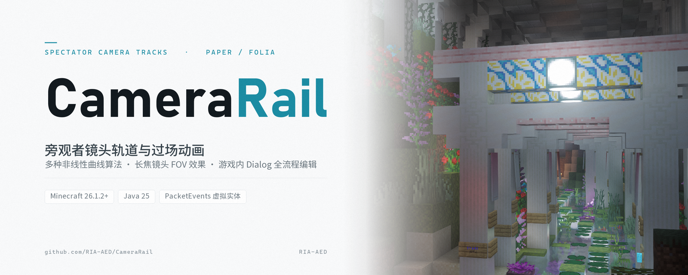

<p align="center">
  
</p>

<p align="center">
  
  
  
  
  
</p>

# CameraRail

CameraRail 是一个面向 **Paper / Folia** 的镜头轨道与过场动画插件。

播放开始时，玩家会被切换为旁观者并锁定镜头；镜头沿 `tracks.yml` 中编排的轨道移动、停留或等待外部信号，播放结束后玩家按配置的落点回到地面。轨道可以手写 YAML，也可以完全在游戏内的图形编辑器中录制和调整。

插件只负责镜头本身。登录验证、小游戏流程、正式传送和流程状态切换仍由你现有的插件负责，它们可以通过 `CameraService`、事件或 `/camerarail` 命令与镜头配合，详见 [插件集成](docs/integration.md)。

## 功能特性

- **7 种轨道步骤**：`move`、`path`、`hold`、`wait`、`cut`、`effect`、`title`
- **平滑运镜**：`path` 可连续穿过多个路径点，曲线平滑、速度均匀；另提供 7 种缓动曲线
- **镜头摇摆**：`off`、`gentle`、`natural`、`strong` 四档预设，也可自定义振幅与周期
- **外部信号**：`wait` 步骤可等待登录完成、倒计时等信号，支持信号提前到达与超时
- **三种退出落点**：镜头最后位置、进入前位置或自定义位置
- **游戏内编辑器**：基于 Paper Dialog 的全屏编辑器，另有命令编辑器；修改即时保存，支持撤销
- **镜头效果**：药水效果、标题与副标题、入场效果；安装 PacketEvents 后支持 FOV、失明雾与夜视雾
- **定位条隐藏**：播放期间隐藏被拍摄玩家的原版定位条（locator bar），正常或异常结束都会恢复
- **崩溃恢复**：玩家退出或服务器崩溃后，下次登录恢复播放前的状态
- **Paper / Folia 双端支持**

## 环境要求

| 项目 | 要求 |
| --- | --- |
| 服务端 | Paper 26.1.2+ 或 Folia 26.1.2+ |
| Java | 25 |
| Minecraft | 26.1.2 |
| 客户端 | 原版 Java 版客户端 |
| PacketEvents | 可选，推荐 2.14.0+ |

PacketEvents 用于增强镜头画面，不是必需依赖，插件也不会打包它。未安装时插件会自动回退到盔甲架镜头：轨道播放、信号、编辑器和 API 全部照常工作，只有依赖镜头实体的画面效果（FOV、失明雾等）不可用。

## 安装

1. 下载 `CameraRail-1.1.0.jar`，放入服务端的 `plugins/` 目录。
2. （可选）把 PacketEvents 2.14.0+ 放入同一目录，以获得完整的 FOV 与雾效。
3. 启动服务器，插件会自动生成默认配置与示例轨道。
4. 编辑 `plugins/CameraRail/tracks.yml`，或进入游戏执行 `/camerarail edit`。
5. 执行 `/camerarail reload`，然后用 `/camerarail play <轨道>` 预览。

首次启动会生成配置和轨道文件，`recovery/` 会在第一次播放时创建：

```text
plugins/CameraRail/
├── config.yml       # 全局配置
├── messages.yml     # 玩家消息（MiniMessage）
├── tracks.yml       # 轨道
└── recovery/        # 播放前的玩家状态，正常结束时删除对应文件
```

## 快速开始

`tracks.yml` 示例：

```yaml
schema-version: 1
tracks:
  login:
    display-name: "登录过场"
    world: world
    start: { x: 0.5, y: 100.0, z: 0.5, yaw: 0, pitch: 10 }
    exit-mode: pre-entry
    entry-effects:
      - effect: darkness
    steps:
      - { type: hold, duration: 40, sway: off }
      - { type: effect, effect: darkness, action: remove }
      - type: move
        to: { x: 8.5, y: 98.0, z: -6.5, yaw: 28, pitch: 6 }
        duration: 100
        easing: ease-in-out
      - { type: wait, signal: "login:ready", timeout: 6000 }
      - type: title
        title: "<gray>欢迎回来</gray>"
        subtitle: "<dark_gray>正在同步你的位置</dark_gray>"
        fade-in: 20
        stay: 60
        fade-out: 20
      - type: path
        duration: 120
        easing: ease-in-out
        points:
          - { x: 2.5, y: 98.5, z: 4.5, yaw: 10, pitch: 3 }
          - { x: 0.5, y: 100.0, z: 0.5, yaw: 0, pitch: 0 }
```

登录流程确认玩家已登录后，由其他插件或命令发送信号：

```text
/camerarail advance login:ready <玩家>
```

`start` 是镜头眼睛的位置；`exit` 是玩家脚部的位置，仅在 `exit-mode: custom` 时使用。默认 `exit-mode` 为 `animation-end`，即停在镜头最后的位置；如果镜头在半空，玩家会按原版规则坠落，需要安全落点时请使用 `pre-entry` 或 `custom`。

信号可以提前发送：如果信号到达时镜头还没走到匹配的 `wait`，插件会先记录，进入该步骤后再消费。每个 `wait` 只消费一次信号；步骤的 `timeout`（tick，`0` 表示不超时）或 `config.yml` 中的 `session.wait-timeout` 控制超时。

## 命令

根命令为 `/camerarail`，别名 `/camera-rail`。

| 命令 | 说明 |
| --- | --- |
| `/camerarail help [命令]` | 查看帮助；带命令名时显示用法、参数和权限 |
| `/camerarail list` | 列出已加载的轨道 |
| `/camerarail info <id>` | 显示轨道详情 |
| `/camerarail play <id> [玩家]` | 播放轨道；只加载一条轨道时可省略 id |
| `/camerarail stop [玩家]` | 停止播放并恢复玩家 |
| `/camerarail advance <信号或*> [玩家]` | 推进等待步骤；`*` 表示当前等待步骤 |
| `/camerarail create <id> [名称]` | 以当前位置和视角创建轨道 |
| `/camerarail delete <id> confirm` | 删除轨道 |
| `/camerarail edit` | 打开图形编辑器 |
| `/camerarail edit help [命令]` | 查看编辑器命令 |
| `/camerarail reload` | 重载配置、消息和轨道 |

控制台执行 `play`、`stop`、`advance` 时必须提供玩家名。有人处于编辑器时，`/camerarail reload` 会被拒绝，避免覆盖未完成的草稿。

命令编辑器常用命令：

```text
/camerarail edit create login 登录过场
/camerarail edit add 100                # 追加移动步骤（当前视角）
/camerarail edit path                   # 追加路径步骤
/camerarail edit point                  # 追加路径点
/camerarail edit hold 40                # 追加停留
/camerarail edit cut 40                 # 追加快切并停留 40t
/camerarail edit wait login:ready       # 追加等待
/camerarail edit effect add darkness
/camerarail edit title 20 60 20 欢迎|正在同步
/camerarail edit select 3               # 选中步骤
/camerarail edit start                  # 起点设为当前视角
/camerarail edit exit                   # 自定义退出点（当前脚下位置）
/camerarail edit exit-mode pre-entry
/camerarail edit preview
/camerarail edit undo
/camerarail edit done
```

每次修改都会异步写入 `tracks.yml`，`/camerarail edit undo` 可撤销最近 30 次修改。完整命令列表和参数见 `/camerarail edit help`。

## 权限

| 权限 | 默认 | 说明 |
| --- | --- | --- |
| `camerarail.command` | OP | 使用根命令和只读命令 |
| `camerarail.play` | OP | 播放轨道 |
| `camerarail.stop` | OP | 停止播放 |
| `camerarail.advance` | OP | 发送等待信号 |
| `camerarail.edit` | OP | 使用游戏内编辑器 |
| `camerarail.manage` | OP | 创建和删除轨道（同时需要 `camerarail.edit`） |
| `camerarail.reload` | OP | 重载配置和轨道 |

`camerarail.command` 只允许执行根命令，不会自动包含其他子权限。只需要播放和查看的场景，可以只授予 `camerarail.command` 与 `camerarail.play`，不要授予 `edit`、`manage` 或 `reload`。

被播放的玩家不需要拥有权限；播放由有 `camerarail.play` 权限的命令发送者或插件发起。

## 配置

`config.yml` 中的时间单位均为 tick，20 tick = 1 秒。

| 键 | 默认 | 说明 |
| --- | --- | --- |
| `defaults.move-duration` | `100` | `move`、`path`、`hold` 未写时长时的默认值 |
| `defaults.easing` | `ease-in-out` | 默认缓动曲线 |
| `defaults.sway` | `natural` | 默认摇摆预设 |
| `defaults.sway-period` | `160` | 摇摆周期 |
| `session.follow-camera` | `true` | 是否让玩家实体跟随镜头跨区块 |
| `session.wait-timeout` | `6000` | `wait` 步骤的默认超时；`0` 表示永不超时 |
| `session.allow-sneak-exit` | `false` | 真实播放中是否允许按 Shift 退出 |
| `session.hide-locator-bar` | `true` | 播放期间是否隐藏被拍摄玩家的原版定位条 |
| `session.recovery` | `true` | 是否启用崩溃恢复 |
| `session.recovery-max-age-hours` | `168` | 恢复文件的最大有效期 |
| `limits.max-steps` | `256` | 单条轨道最大步骤数 |
| `limits.max-path-points` | `128` | 路径步骤最大路径点数 |
| `limits.max-track-ticks` | `72000` | 单条轨道定时步骤的总时长上限 |
| `debug` | `false` | 输出镜头同步和姿态调试日志 |

玩家消息和帮助文本使用 MiniMessage，可在 `messages.yml` 中按服务器风格修改。

## 轨道格式

### 轨道字段

| 字段 | 类型 | 必填 | 说明 |
| --- | --- | --- | --- |
| `display-name` | string | 否 | 显示名称；默认使用轨道 id |
| `description` | string | 否 | 轨道说明 |
| `world` | string | 是 | 轨道所在世界，必须与服务器加载的世界名一致 |
| `start` | pose | 是 | 起始镜头姿态（眼睛位置） |
| `exit-mode` | string | 否 | `animation-end`（默认）、`pre-entry` 或 `custom` |
| `exit` | pose | 否 | 玩家脚部落点，仅 `exit-mode: custom` 时使用 |
| `sway` | preset / map | 否 | 轨道默认摇摆；默认取 `config.yml` |
| `follow` | boolean | 否 | 玩家实体是否跟随镜头跨区块；默认取配置 |
| `entry-effects` | list | 否 | 进入镜头前施加的效果，只能添加 |
| `steps` | list | 否 | 有序步骤；可以为空 |

轨道 id 只能包含字母、数字、`-` 和 `_`，最长 64 字符；id 不区分大小写，加载和保存时统一使用小写。所有坐标都是 `world` 中的绝对坐标。

### 步骤类型

| 类型 | 说明 | 关键字段 |
| --- | --- | --- |
| `move` | 从当前姿态平滑移动到目标姿态 | `to`、`duration`、`easing`、`sway` |
| `path` | 连续穿过多个路径点 | `points`、`duration`、`easing`、`sway` |
| `hold` | 保持当前姿态 | `duration`、`sway` |
| `wait` | 保持当前姿态直到收到信号或超时 | `signal`、`timeout`、`sway` |
| `cut` | 瞬切到目标姿态，然后可选停留一段时间 | `to`、`duration`、`sway` |
| `effect` | 添加或移除药水效果 | `effect`、`action`、`amplifier`、`duration` |
| `title` | 发送标题和副标题 | `title`、`subtitle`、`fade-in`、`stay`、`fade-out` |

`path` 的 `points` 是当前姿态之后的路径点，至少一个。`easing` 可选 `linear`、`ease-in`、`ease-out`、`ease-in-out`、`smoothstep`、`smootherstep`、`sine`。`wait` 的 `timeout` 省略时使用 `session.wait-timeout`。`title` 的文本使用 MiniMessage。`effect` 的 `action` 默认 `add`，`duration` 省略或为 `0` 时持续到显式移除或轨道结束。同一轨道内的 `wait` 信号名不能重复。`cut` 的 `duration` 省略或为 `0` 时是纯瞬时硬切，不占用时间轴；正整数 N 表示硬切后在新姿态停留 N tick，计入轨道总时长。

### 退出落点

| `exit-mode` | 行为 |
| --- | --- |
| `animation-end` | 默认。结束时停在镜头最后的位置，按未叠加摇摆的基准姿态换算到玩家脚部 |
| `pre-entry` | 回到进入镜头前的位置 |
| `custom` | 使用 `exit` 指定的玩家脚部位置和朝向 |

只写了 `exit` 而没有写 `exit-mode` 时按 `custom` 处理。退出点是玩家脚部坐标，不会额外提供飞行或无敌；请确保落点安全。

### 摇摆

`sway` 可使用预设 `off`、`gentle`、`natural`、`strong`，也可以写 YAML 映射，以 `preset` 为基础并覆盖 `x`、`y`、`z`、`yaw`、`pitch`、`period`、`seed`。步骤可以覆盖为 `inherit` 或某个预设；覆盖只改变振幅，周期和种子仍来自轨道。

预设档位的 `yaw` 为 `0`，只做位置漂移和轻微俯仰；需要左右转头时，在自定义映射中显式设置 `yaw`。YAML 会把未加引号的 `off` 解析为布尔值，插件按 `off` 处理。

完整的字段、校验规则和更多示例见 [tracks.yml 字段参考](docs/yaml-reference.md)。

## 游戏内编辑器

`/camerarail edit`（或 `/camerarail edit gui`）打开 Paper 的 Dialog 全屏编辑器，不需要额外依赖或客户端 mod。

- 轨道列表：选择已有轨道，或以当前视角新建轨道。
- 轨道概览：查看步骤、总时长和摇摆；编辑轨道设置、起点、退出点、入场效果；预览整条轨道。
- 步骤表单：按类型编辑全部字段，支持保存并返回、上一步/下一步、上移/下移、复制、删除和单步预览。
- 坐标表单提供“取当前视角/取当前脚下位置”和“传送到此”；取到当前姿态就立即写入已保存的起点、步骤目标或路径点，传送到此前会先保存编辑框里的坐标。
- 起点和步骤按眼睛坐标记录，退出点按脚部坐标记录。
- 硬切步骤表单在目标姿态之外提供“硬切后停留”时长（tick，`0` 表示纯瞬时）。
- 路径步骤有独立的路径点列表，可追加当前视角、插入、删除和上下移动；路径点表单的“取当前视角”会立即保存该点，“插入当前视角”会先保存当前点再插入。
- 等待步骤可以复用已有信号；效果步骤提供常用效果列表，也允许输入任意注册 id。
- 表单里的“保存”只提交编辑框里的数值（步骤/路径点表单留在原表单；轨道设置、入场效果、起点/退出点保存后回到上一层）；预览、上一步/下一步、上移/下移、复制、传送到此等按钮会先保存编辑框再执行，窗口底部的“保存并关闭”和 Esc 也会先保存再关闭。只有“取消”和“删除”会丢弃未保存的输入；新建步骤/入场效果/轨道的“关闭”仍是取消，不会创建。所有修改立即自动保存，可撤销最近 30 次；按 Esc 关闭后再执行 `/camerarail edit` 会回到上次的界面和页码。

对话框依赖 Paper 26.1.2 的 Dialog API。命令编辑器不依赖 Dialog，始终可用，适合快速追加步骤或微调参数。

## 开发者 API

通过 Bukkit 的 `ServicesManager` 获取 `CameraService`：

```java
CameraService cameras = Bukkit.getServicesManager().load(CameraService.class);
if (cameras != null) {
    cameras.play(player, "login");
    cameras.advance(player, "login:ready");
}
```

常用方法：

```java
Set<String> trackIds();
boolean isPlaying(Player player);
Optional<PlaybackInfo> playback(Player player);
Optional<String> waitingSignal(Player player);

boolean play(Player player, String trackId);
boolean stop(Player player);
boolean advance(Player player, String signal);
boolean advance(Player player);

int reload();
```

`play` 返回 `true` 只表示请求已受理，不保证第一帧已经渲染；实际结束以 `CameraTrackEndEvent` 为准。播放相关方法可以从任意线程调用，`reload()` 请在服务端线程执行。

事件：

| 事件 | 触发时机 | 说明 |
| --- | --- | --- |
| `CameraTrackStartEvent` | 玩家被切换为旁观者之前 | 可取消；取消后玩家状态不变，也不会触发结束事件 |
| `CameraWaitEvent` | 进入 `wait` 步骤时 | 提供 `signal()`、`timeoutTicks()` 和 `preview()` |
| `CameraTrackEndEvent` | 玩家被释放、状态恢复之后 | 提供 `reason()`、`completed()` 和 `preview()` |

`completed()` 仅在轨道自然走完并成功把玩家放到退出位置时为 `true`。`EndReason` 包括 `FINISHED`、`STOPPED`、`QUIT`、`KICKED`、`TIMEOUT`、`LIMIT`、`CAMERA_LOST`、`EXTERNAL_TELEPORT`、`GAME_MODE_CHANGE`、`WORLD_CHANGE`、`DEATH`、`ERROR` 和 `RECOVERED`。

更完整的集成顺序、AuthMe 示例和事件用法见 [插件集成](docs/integration.md)。

## 常见问题

### 没有安装 PacketEvents 会怎样？

插件自动回退到盔甲架镜头，轨道播放不受影响。启动日志会有一条 WARN；播放依赖镜头实体的效果时，聊天栏会提示当前为回退模式，`/camerarail info <id>` 和编辑器也会显示镜头模式。回退模式下 `nausea` 完整生效，`darkness` 部分生效、`night_vision` 大部分生效，`blindness` / `slowness` 没有画面变化。详见 [旁观者镜头下的药水效果](docs/spectator-effects.md)。

### 玩家中途退出或服务器崩溃了怎么办？

默认开启崩溃恢复（`session.recovery`）。播放前会把玩家状态写入 `recovery/`；正常结束删除，中途退出或崩溃则保留，下次登录自动恢复位置、游戏模式、飞行状态和药水效果。超过 `session.recovery-max-age-hours`（默认 168 小时）的文件会在下次登录读取时删除。请勿手动删除正在使用的恢复文件。

### 其他插件传送玩家会打断镜头吗？

会。镜头期间的外部传送会结束播放并交还控制权（插件不会抢回位置），这是为了避免两个插件互相传送。请先 `/camerarail stop`，或把传送推迟到 `CameraTrackEndEvent` 之后。原版旁观者的数字键/旁观菜单传送是例外：镜头锁定期间会被拦下并保持锁定。

### 预览和真实播放有什么区别？

预览使用同一套轨道和步骤，区别有三点：预览总是可以按 Shift 结束；预览结束后会回到预览前的位置，而不是按 `exit-mode` 落点；从中间步骤开始的预览不会回放之前的 `effect` / `title` 步骤，也不施加入场效果（从轨道起点开始则与真实播放一致）。

### 玩家可以自己退出镜头吗？

默认不行。`session.allow-sneak-exit` 为 `false` 时，真实播放中按 Shift 不会结束镜头（预览总是允许）；需要结束请由管理员执行 `/camerarail stop`。

### 支持 Folia 吗？

支持。插件声明了 `folia-supported`，使用区域调度器处理镜头实体与玩家操作，没有全局 tick 任务；在 Paper 与 Folia 上功能一致。

## 已知限制

- 假玩家镜头不是完整客户端渲染：全屏渐变/黑场、水下/着火/方块贴脸等叠加层不可用，FOV 只能通过药水等级（`slowness`/`speed`）表达。
- 极慢的旋转镜头可能有轻微的台阶感与短暂跟随滞后（旁观原版玩家时也一样），位置与俯仰不受影响。
- 通过 ViaVersion/ViaBackwards 等跨版本链路时，FOV 与部分画面效果可能不完整；建议在 26.1.2 原生客户端上确认效果。
- 一条轨道只能属于一个世界。
- 编辑器保存会重写整个 `tracks.yml`，只保留文件头注释；文件中存在无法解析的轨道时，编辑器会拒绝保存，需要先修复并执行 `/camerarail reload`。
- 不支持循环轨道、多轨道叠加或任意命令步骤；流程编排交给其他插件。
- 镜头锁定依赖客户端支持原版的旁观相机切换；少数第三方客户端或跨版本链路可能无法锁定镜头。
- 定位条隐藏依赖 26.1.2 服务端提供的对应属性；服务端不提供时会记录一次 WARN 并继续播放（定位条保持可见）。
- 自定义 `sway` 的 `yaw` 在部分客户端可能出现短促的水平回抽；预设档位 `yaw` 为 `0`，默认不会触发。

更深入的同步细节、协议限制与回退日志见 [实现说明](docs/implementation.md)。

## 文档

- [tracks.yml 字段参考](docs/yaml-reference.md)
- [插件集成与事件](docs/integration.md)
- [旁观者镜头下的药水效果与假玩家摄像机](docs/spectator-effects.md)
- [定位条（locator bar）与播放期间隐藏](docs/locator-bar.md)
- [实现说明](docs/implementation.md)

## 构建

需要 Java 25 和 Maven：

```text
mvn package
```

产物为 `target/CameraRail-1.1.0.jar`。运行 `mvn test` 可执行单元测试。

## 反馈

- 问题与建议：[GitHub Issues](https://github.com/RIA-AED/CameraRail/issues)
- 版本更新：[GitHub Releases](https://github.com/RIA-AED/CameraRail/releases)

## 许可

CameraRail 由 RIA-AED 维护，基于 [MIT 许可证](LICENSE) 开源。你可以自由使用、修改、再发布和商用，只需保留版权声明与许可证文本。

MIT 只覆盖本仓库的代码与文档；Minecraft 的素材与截图中的游戏内容版权归 Mojang 所有。